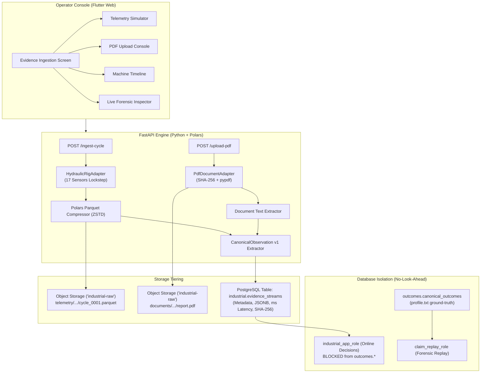

# Lotew Industrial (`lotew-industrial`)

High-integrity industrial telemetry and documentary evidence ingestion engine.
Architected specifically for physical plant monitoring (UCI Hydraulic Systems Test Rig) with strict temporal causality and forensic traceability.

---

## 🏛️ System Architecture



---

## 🚀 Quickstart Guide

### 1. Database Setup (Supabase)
Run the migration script in your Supabase SQL Editor:
- **File:** `database/migrations/001_industrial_core_schema.sql` (or `Downloads/lotew_industrial_supabase_schema.sql`)
- Fully idempotent: can be executed safely multiple times without `ERROR: 42710`.
- Configures schemas: `platform`, `industrial`, `outcomes`.
- Establishes DB roles: `industrial_app_role` (blocked from outcomes) & `claim_replay_role`.
- Seeds tenants (`hydraulic_lab`, `metro_porto`, `scania_fleet`, `petrobras_3w`) and rig components.

### 2. Run the FastAPI Backend
```bash
cd lotew_industrial/backend

# Run the 11 automated unit & integration tests
python3 -m pytest tests -v

# Start the local development server
python3 -m uvicorn app.main:app --reload --host 0.0.0.0 --port 8000
```
- Interactive Swagger UI: [http://localhost:8000/docs](http://localhost:8000/docs)
- Health Check: [http://localhost:8000/health](http://localhost:8000/health)

### 3. Run the Flutter Web Console
```bash
cd lotew_industrial/frontend

# Run tests
flutter test

# Run Flutter Web in Google Chrome
flutter run -d chrome
```

---

## ⏱️ Forensic 3-Timestamp Architecture
Every record in `industrial.evidence_streams` enforces temporal causality down to the millisecond:
1. `event_time`: The physical occurrence in the real world.
   - For Telemetry: $\text{event\_time} = \text{Anchor Epoch} + (N - 1) \times 60 \text{ seconds}$.
   - Default Anchor Epoch: `2024-01-01T00:00:00.000Z`.
2. `ingestion_time`: Moment the raw byte payload entered the API gateway (`TIMESTAMPTZ(3)`).
3. `available_time`: Moment the compressed Parquet/PDF was persisted and canonical JSON became queryable.
4. Latency Differentials:
   - `ingestion_latency_ms`: Transport delay from physical occurrence to gateway.
   - `processing_latency_ms`: Execution duration of the Polars compression and JSON extraction.

---

## 📊 UCI Hydraulic Sensor Breakdown (17 Sensors)
- **100 Hz (6,000 samples/cycle):** `PS1`, `PS2`, `PS3`, `PS4`, `PS5`, `PS6`, `EPS1`
- **10 Hz (600 samples/cycle):** `FS1`, `FS2`
- **1 Hz (60 samples/cycle):** `TS1`, `TS2`, `TS3`, `TS4`, `CE`, `CP`, `SE`, `VS1`
- **Storage:** Uncompressed multi-rate waveforms are compressed with Polars ZSTD into single Parquet files (~24 KB / cycle) in Supabase Storage (`industrial-raw`).

