# ⚖️ Lotew Multi-Role Platform: Zero-Loophole Master Blueprint & Client Proposal (Hinglish)
**Document:** Master Technical Blueprint & Client Proposal Foundation (Zero-Loophole Certified)  
**Target:** Team Lead (Vir), Core Engineering Team & Client Call Review  
**Focus:** 4-Tier User Hierarchy, 2-Console Dynamic Gating, Service & Maintenance Verification Pipeline, Dual Policy Clause Rejection, High-Scale Performance Architecture & Prototype Execution  
**Language:** Professional Hinglish (Technical Architecture + Clear Hindi Explanations)  

---

## 🛡️ ZERO-LOOPHOLE AUDIT SUMMARY (System Architect & Legal Defensibility)

Iss master document me heavy equipment rental, warranty disputes, aur insurance claim adjudication ke **saare practical loopholes 100% seal** kar diye gaye hain:

| Dispute Defense (Operator / Contractor Ka Bahana) | Lotew Cryptographic Evidence (Hum Kaise Prove Karenge) | Policy Clause Breached |
| :--- | :--- | :--- |
| **1. "Machine delivery ke time hi kharab thi"** *(Pre-existing defect)* | **Handover Baseline Certificate (Cycle 1665):** Delivery time par machine 100% nominal thi (Cooler: 100%, Leak: 0.0, Flow: 10.1 L/min). SHA-256 sealed. | Rental Agreement Handover Clause 1.4 |
| **2. "Machine achanak bina warning ke toot gayi"** *(Sudden unavoidable loss)* | **Live Telematics Telemetry (Cycle 211):** Flow meter FS1 10.1 se gir kar 2.15 L/min hua. ISO-13374 Level 2 degradation alarm log hua. | Clause 4.1 (Active Monitoring Requirement) |
| **3. "Mujhe cab me koi alert ya warning nahi mili"** *(No alert received)* | **Operator Telematics In-Cab Console Audit:** Telematics screen par 14:02 UTC par alert deliver hua. Operator ne `[ Dismiss Alert ]` click kiya. | Clause 4.2 (Willful Disregard of Warning) |
| **4. "Humne toh regular service karwayi thi"** *(Maintenance claimed)* | **CMMS / ERP Work Order Cross-Check:** Database ne rental yard aur contractor ke maintenance records scan kiye $\rightarrow$ **ZERO SERVICE WORK ORDER FOUND**. 2 ghante ka maintenance SLA miss kiya aur machine 14 cycles bina service chalayi. | **Clause 3.1 (Mandatory Maintenance Compliance)** & **Clause 4.2 (Failure to Mitigate)** |

---

## 👑 1. User Priority Hierarchy & Scope (5 Commercial Roles)

Industry-standard industrial/forensic platforms me user access ko **5 Commercial Personas** me divide kiya gaya hai taaki zero authorization conflicts aur realistic enterprise governance rahe:

```
┌────────────────────────────────────────────────────────────────────────────────────────────────────────┐
│                                   5 COMMERCIAL ROLES HIERARCHY                                         │
├─────────┬──────────────────────┬────────────────────────┬──────────────────────────────────────────────┤
│ Tier    │ Role Name            │ Kaun Hai (Who)         │ System Superiority & Operational Scope       │
├─────────┼──────────────────────┼────────────────────────┼──────────────────────────────────────────────┤
│ Role 1  │ 👑 LOTEW ADMIN       │ Us (Lotew Core Team)   │ SUPER ADMIN (Cross-Tenant Root)              │
│         │ (admin@lotew.io)     │                        │ Highest authority. Global Fleet Directory    │
│         │                      │                        │ (/admin) par 48 rigs & all tenants dekhta hai│
├─────────┼──────────────────────┼────────────────────────┼──────────────────────────────────────────────┤
│ Role 2  │ 🏗️ RENTAL YARD MGR   │ Equipment Owner        │ ASSET LESSOR (Owner-Scoped)                  │
│         │ (manager@titan.com)  │ (Titan Rentals Heavy)  │ Fleet health, Handover Nominal Baseline      │
│         │                      │                        │ (Cycle 1665) cert, active dispute status.    │
├─────────┼──────────────────────┼────────────────────────┼──────────────────────────────────────────────┤
│ Role 3  │ 👷 FLEET OPERATOR    │ Job-Site Contractor    │ CABIN OPERATOR (Job-Site Renter)             │
│         │ (operator@dealer.com)│ (ABC Infrastructure)   │ In-Cab screen (/console) par live alarm      │
│         │                      │                        │ dekhta hai: [Dispatch Tech] vs [Dismiss].    │
├─────────┼──────────────────────┼────────────────────────┼──────────────────────────────────────────────┤
│ Role 4  │ 🛡️ INSURER ADJUSTER  │ Third-Party Insurer    │ CLAIMS ADJUDICATION (Policy-Scoped)          │
│         │ (claims@allianz.com) │ (Allianz SE)           │ Dedicated portal (/claim-replay) par 3-stage │
│         │                      │                        │ stepper, automated denial & 2 action buttons.│
├─────────┼──────────────────────┼────────────────────────┼──────────────────────────────────────────────┤
│ Role 5  │ 🏛️ EXTERNAL AUDITOR  │ Independent Certifier  │ CRYPTOGRAPHIC ASSURANCE (ISO-13374)          │
│         │ (auditor@tuv.com)    │ (TÜV SÜD)              │ Dedicated hash ledger (/auditor) with 42     │
│         │                      │                        │ contiguous linear SHA-256 blocks & ZIP pack. │
└─────────┴──────────────────────┴────────────────────────┴──────────────────────────────────────────────┘
```

---

## 🏢 1.1 Organizational Hierarchy & Scoped Insurance Binding (Dummy Data Setup)

```
                                👑 LOTEW SUPER ADMIN (Multi-Tenant Root)
                                                  │
                ┌─────────────────────────────────┴─────────────────────────────────┐
                ▼                                                                   ▼
       🏗️ RENTAL YARD MANAGER: Titan Rentals Heavy                         Rental Yard B: Apex Fleet
       (Equipment Owner / Lessor • Owns 14 Machines)
                │
    ┌───────────┴───────────────────────────────────────────┐
    ▼                                                       ▼
👷 FLEET OPERATOR: ABC Infrastructure                 Contractor 2: Delta Heavy Works
(Job-Site Renter • Excavator Rig #01)
    │
    ▼ [Policy #POL-ALLZ-8812]
🛡️ INSURER ADJUSTER: Allianz SE (Adjudicates Claim CLM-2026-9042 • $18,500)
    │
    ▼ [Compliance Assurance]
🏛️ EXTERNAL AUDITOR: TÜV SÜD (Offline RFC 8785 Hash Chain Verification)
```
    ┌───────────┴───────────────────────────────────────────┐
    ▼                                                       ▼
Operator 1: ABC Infrastructure               Operator 2: Delta Heavy Works
(Allotted: Rig #01 & Rig #02)                (Allotted: Rig #03)
    │                                                       │
    ▼ [Insured By Policy #POL-ALLZ-8812]                    ▼ [Insured By Policy #POL-ZUR-4419]
🛡️ Insurer A: ALLIANZ SE                                🛡️ Insurer B: ZURICH INSURANCE
(CAN ONLY SEE RIG #01 & #02)                           (CAN ONLY SEE RIG #03)
```

### 🔒 Strict Data Scoping & Time-Bound Policy Rule (Zero Leakage Guarantee)
* **Allianz Insurer Login (`claims@allianz.com`):**
  - Database engine query run karta hai:  
    `WHERE policy.insurer_id = 'ALLIANZ' AND policy.status = 'ACTIVE' AND telemetry.timestamp BETWEEN policy.coverage_start AND policy.coverage_end`
  - Allianz adjuster ko **sirf aur sirf Operator 1 (ABC Infrastructure) ki machines (Rig #01 aur Rig #02)** dikhengi.
  - Allianz ko Operator 2 (Zurich) ki Rig #03 ya kisi aur rental operator ka ek bhi byte data nahi dikhega.
* **Temporal Machine Re-assignment:**  
  Agar Rig #01 agle quarter me kisi naye operator ko di jaati hai, toh purana insurer sirf apne policy window (`coverage_start` to `coverage_end`) ka data hi dekh sakta hai.

---

## 🛠️ 1.2 The Core Evidence Pillar: Telematics + Maintenance Work Orders (Dual Cross-Check)

Lotew sirf sensor reading nahi dekhta; Lotew ka sabse bada strength hai **Physical Sensor Telemetry + ERP Maintenance Work Orders ka Mathematical Cross-Check**.

### Do (2) Tarah Ke Service Alerts Jinke Miss Hone Par Claim Reject Hota Hai:

```mermaid
flowchart TD
    subgraph S1["SCENARIO A: Incident-Driven Service Neglect (Reactive)"]
        A1["Cycle 211: Pump Internal Leak Detected<br/>Flow FS1 drops to 2.15 L/min"] --> A2["Service Alert: Replace Hydraulic Seal<br/>2-Hour SLA Countdown Starts"]
        A2 --> A3{"Operator Action"}
        A3 -- "Dispatch Service Ticket" --> A4["🛠️ Work Order Created (#WO-9912)<br/>Seal Replaced -> Machine NOMINAL"]
        A3 -- "Dismiss Alert / Ignore Service" --> A5["❌ SERVICE MISSED<br/>Operates 14 cycles unserviced"]
        A5 --> A6["Cycle 226: Total Pump Seizure ($18,500)<br/>Breach: Clause 3.1 & 4.2 -> ❌ CLAIM DENIED"]
    end

    subgraph S2["SCENARIO B: Scheduled Preventative Maintenance Overdue (Periodic)"]
        B1["Milestone: 500-Hour / 1,500-Cycle Hydraulic Oil & Filter Service Due"] --> B2["Maintenance Alert: Scheduled PM Overdue"]
        B2 --> B3{"Rental Yard / Contractor Action"}
        B3 -- "Complete PM Service" --> B4["🛠️ Oil & Filter Replaced<br/>CMMS Log Verified"]
        B3 -- "Skip / Delay PM Service" --> B5["❌ SCHEDULED SERVICE SKIPPED<br/>Sludge accumulates in valves"]
        B5 --> B6["Valve Jam & Cylinder Damage ($24,000)<br/>Breach: Clause 3.1 (Maintenance Compliance) -> ❌ CLAIM DENIED"]
    end
```



---

## 🖥️ 2. The 2-Console Dynamic Capability Matrix

Frontend me 10 alag screens banane ke bajaye **2 Unified Consoles** hain, jo user ke role ke according dynamically adapt ho jaate hain:

1. **Console 1: Operations & Ingestion Workspace**
## 🎛️ 2. Dedicated Multi-Page Enterprise Architecture

Ek congested dashboard ke badle humne **4 Dedicated Enterprise Pages** banaye hain taaki har role ko realistic SaaS look mile aur zero UI confusion rahe:

1. **Page 1: Super Admin Global Fleet Directory (`/admin`)** — Super Admin home page (48 rigs across 3 rental yards, 4 quick portal launchers, KPI cards).
2. **Page 2: Rig Operations & Health Console (`/console`)** — Rig #01 focused asset view (KPI tiles, In-Cab Level 2 pump leak alarm, Handover Baseline, live diagnostic waveforms).
3. **Page 3: Allianz Insurance Adjudication Portal (`/claim-replay`)** — Claim CLM-2026-9042 dispute adjudication (3-milestone stepper, dynamic recommendation, Adjuster findings, and the 2 Fiduciary Buttons: `[ Confirm Denial ]` & `[ Approve Payout ]`).
4. **Page 4: TÜV SÜD Cryptographic Proof Ledger (`/auditor`)** — 42 contiguous linear SHA-256 blocks with zero-tamper indicator and one-click ZIP download.

```
┌──────────────────────────────────────────────────────────────────────────────────────────────────────────┐
│                                   5-ROLE MULTI-PAGE CAPABILITY MATRIX                                    │
├──────────────────────────────┬──────────────────┬──────────────────┬──────────────────┬──────────────────┬──────────────────┤
│ Feature / Screen             │ 👑 Super Admin   │ 🏗️ Rental Yard   │ 👷 Fleet Operator│ 🛡️ Insurer       │ 🏛️ External      │
│                              │ (/admin)         │ (/console)       │ (/console)       │ (/claim-replay)  │ Auditor (/auditor│
├──────────────────────────────┼──────────────────┼──────────────────┼──────────────────┼──────────────────┼──────────────────┤
│ Global Fleet Directory (48)  │ ✅ Primary View  │ 🔒 Own Fleet (14)│ 🔒 Assigned Rig  │ 🚫 Hidden        │ 🚫 Hidden        │
│ Stakeholder Quick-Launchers  │ ✅ 4 Launchers   │ 🔒 View Own      │ 🚫 Hidden        │ 🚫 Hidden        │ 🚫 Hidden        │
│ Rig #01 Handover Cert (#1665)│ ✅ Inspect       │ ✅ Primary Proof │ 🔒 View Baseline │ ✅ Scrutinize    │ ✅ Verify Hash   │
│ In-Cab Level 2 Alarm (#211)  │ 🔒 Monitor       │ 🔒 Monitor       │ ✅ PRIMARY ALERT │ 🚫 Hidden        │ 🚫 Hidden        │
│ [ 🛠️ Dispatch Service Tech ] │ 🔒 Simulated     │ 🔒 Authorized    │ ✅ ACTIVE ACTION │ 🚫 Disabled      │ 🚫 Disabled      │
│ [ ⚠️ Dismiss Alert & Run ]   │ 🔒 Simulated     │ 🚫 Unauthorized  │ ✅ ACTIVE ACTION │ 🚫 Disabled      │ 🚫 Disabled      │
│ 3-Milestone Replay Stepper   │ ✅ Full Access   │ 🔒 Track Claim   │ 🚫 Hidden        │ ✅ PRIMARY FOCUS │ ✅ Step Audit    │
│ Dynamic Verdict (DENIAL)     │ ✅ Inspect Engine│ 🔒 View Outcome  │ 🚫 Hidden        │ ✅ PRIMARY FOCUS │ ✅ Read-Only     │
│ [ ❌ Confirm Claim Denial ]  │ 🔒 Simulated     │ 🚫 Unauthorized  │ 🚫 Unauthorized  │ ✅ FIDUCIARY ACT │ 🚫 Disabled      │
│ [ 🟢 Approve Payout ]        │ 🔒 Simulated     │ 🚫 Unauthorized  │ 🚫 Unauthorized  │ ✅ FIDUCIARY ACT │ 🚫 Disabled      │
│ 42-Block SHA-256 Hash Chain  │ ✅ Verify Engine │ 🔒 View Status   │ 🚫 Hidden        │ ✅ Verify Proof  │ ✅ PRIMARY AUDIT │
│ Export Standalone ZIP Dossier│ ✅ Full Export   │ 🔒 Summary PDF   │ 🚫 Hidden        │ ✅ FULL DOSSIER  │ ✅ VERIFICATION  │
└──────────────────────────────┴──────────────────┴──────────────────┴──────────────────┴──────────────────┴──────────────────┘
```

---

## 🖥️ 3. Screen Mockups: Service Dispatch & Missed Maintenance Adjudication

### Console 1: Operations Workspace (Active Service Alert Card)

```
┌──────────────────────────────────────────────────────────────────────────────────────────────────────────┐
│ LOTEW INDUSTRIAL ASSURANCE | PORT 8000            [ ACTIVE PERSONA: 👷 FLEET OPERATOR ▾ ] [ CONSOLE 1 ] │
├──────────────────────────────────────────────────────────────────────────────────────────────────────────┤
│ TENANT: [ Titan Rentals ▾ ]  |  ASSET: hydraulic_rig_01 (Excavator Rig #01 - ABC Infrastructure)        │
├──────────────────────────────────────────────────────────────────────────────────────────────────────────┤
│ PRE-RENTAL HANDOVER BASELINE (PROOF OF HEALTHY DELIVERY):                                                │
│ • Cycle #1665 (Handover: 2024-01-01 09:00 UTC) | Status: 🟢 100% NOMINAL (Cooler: 100%, Leak: 0.0)      │
│ • Cryptographic Baseline Seal: sha256:53418536ae968dc51d46b7a0b5a3fa7166113bdf2d0014a4b49195b0042da09c    │
├──────────────────────────────────────────────────────────────────────────────────────────────────────────┤
│ 🚨 ACTIVE SERVICE & MAINTENANCE ALERT [CYCLE 211, 14:00 UTC]:                                            │
│ Component: Main Hydraulic Pump | Condition: 🟡 DEGRADED (Flow dropped to 2.15 L/min)                     │
│ Mandatory Requirement: Hydraulic Seal Inspection & Technician Service.                                   │
│ Service Policy SLA: ⏱️ 2.0 Operating Hours remaining before Warranty & Insurance VOID.                   │
├──────────────────────────────────────────────────────────────────────────────────────────────────────────┤
│ OPERATOR SERVICE ACTIONS:                                                                                │
│                                                                                                          │
│   [ 🛠️ DISPATCH SERVICE TICKET & PARK RIG ]     [ ⚠️ DISMISS ALERT & CONTINUE RUNNING ]                 │
│   (Creates CMMS Work Order #WO-9912)            (SKIPS SERVICE: Logs Willful Neglect)                    │
│                                                                                                          │
└──────────────────────────────────────────────────────────────────────────────────────────────────────────┘
```

---

### Console 2: Claim Replay Workspace (Missed Service Audit & 2 Determination Buttons)

```
┌──────────────────────────────────────────────────────────────────────────────────────────────────────────┐
│ LOTEW CLAIM REPLAY CONSOLE | ALLIANZ GLOBAL CLAIMS DIVISION         [ ACTIVE PERSONA: 🛡️ INSURER ▾ ]     │
├──────────────────────────────────────────────────────────────────────────────────────────────────────────┤
│ DISPUTE IDENTIFIER: CLM-2026-9042 ($18,500.00 Claimed) | Policy: #POL-ALLZ-8812 | Asset: hydraulic_rig_01│
│ RETROSPECTIVE TIMELINE SLIDER (Time T):                                                           │
│ [ Handover: Cycle 1665 🟢 ] ──────────────●────────────── [ Seizure: Cycle 226 🔴 ] (Selected: Cycle 211)│
├──────────────────────────────────────────────────────────────────────────────────────────────────────────┤
│ 📋 RECONSTRUCTED AUDIT TRAJECTORY (CROSS-EVIDENCE CHECK):                                                │
│ • 09:00 UTC (Cycle 1665): Baseline Healthy Delivery (Handover Cert: sha256:5341...)      🟢 NOMINAL      │
│ • 14:00 UTC (Cycle 0211): Pump Leak Detected (Flow: 2.15 L/min). Service Warning Issued.  🟡 WARNING      │
│ • 14:02 UTC (Cycle 0211): Mandatory Service Alert Delivered to Operator Cab Console.     ✓ DELIVERED    │
│ • 14:05 UTC (Cycle 0211): Operator Action: Operator clicked [ Dismiss Alert & Run ].     ❌ DISMISSED   │
│ • 14:06 UTC (Cycle 0211): CMMS ERP Work Order Query: Search for technician dispatch.     ❌ NO RECORD    │
│ • 16:00 UTC (Cycle 0215): 2-Hour Service SLA Expired. Machine continued running unserviced. 🔴 BREACH     │
├──────────────────────────────────────────────────────────────────────────────────────────────────────────┤
│ ⚖️ LOTEW SYSTEM VERDICT: ❌ RECOMMEND CLAIM DENIAL (Authority Score: 0.94)                                │
│ Primary Ground: LOSS CAUSED BY FAILURE TO PERFORM MANDATORY SERVICE UPON TELEMATICS ALARM.              │
│ Policy Clause Breached: Clause 3.1 (Maintenance Adherence) & Clause 4.2 (Mitigation of Loss).           │
│ Recommended Indemnity Payout: $0.00                                                                      │
│ Cryptographic Block Hash: sha256:e3b0c44298fc1c149afbf4c8996fb92427ae41e4649b934ca495991b7852b855        │
├──────────────────────────────────────────────────────────────────────────────────────────────────────────┤
│ ✍️ ADJUSTER FINAL DETERMINATION (LEGAL SIGN-OFF):                                                        │
│ Adjuster Notes: [ Operator willfully dismissed Cycle 211 service alert. No maintenance work order raised.│
│                   Unserviced operation caused seizure. Claim Denied per Clause 3.1 & Clause 4.2. ]       │
│                                                                                                          │
│       [ ❌ Confirm Claim Denial ]                      [ 🟢 Approve Payout ]                             │
│                                                                                                          │
├──────────────────────────────────────────────────────────────────────────────────────────────────────────┤
│ [ 📥 EXPORT FORENSIC DOSSIER (PDF + Canonical JSON) ]     [ 🐍 DOWNLOAD STANDALONE verify_chain.py ]     │
└──────────────────────────────────────────────────────────────────────────────────────────────────────────┘
```

---

## ⚡ 4. Large-Scale Enterprise Performance Architecture (Zero-Crash, Sub-100ms)

```
┌────────────────────────────────────────────────────────────────────────────────────────┐
│                   ENTERPRISE HIGH-SCALE DATA TIERING PIPELINE                          │
├────────────────────────────────────────────────────────────────────────────────────────┤
│                                                                                        │
│  [ Raw 100Hz Physical Sensors ] (100 readings / sec per sensor)                        │
│          │                                                                             │
│          ▼ (Partner Dev Pipeline)                                                      │
│  📦 COLD STORAGE: S3 / Object Storage Parquet Chunks                                   │
│     * Millions of raw rows live in cheap object storage, NOT in PostgreSQL!            │
│          │                                                                             │
│          ▼ (Summary Extraction & Physics Engine)                                       │
│  🔥 HOT STORAGE: PostgreSQL Core Tables (Metadata & Aggregates Only)                   │
│     * 1 Cycle (60s) = Exactly 1 Row in `industrial.evidence_streams`                   │
│     * Stores: Cycle Duration, Max Pressure, Min Flow, State Delta, Hash                │
│     * 100M raw sensor points condense into 1,440 lightweight rows per machine/day      │
│          │                                                                             │
│          ▼ (Downsampled API - LTTB Algorithm)                                          │
│  ⚡ FAST REST / WEBSOCKET API (FastAPI)                                                │
│     * Timeline Scrubbing: Delivers only 500 downsampled points for graphs              │
│     * API Response Time: < 35ms (Even across 100,000 cycles)                           │
│          │                                                                             │
│          ▼ (Virtualized Canvas)                                                        │
│  📱 FLUTTER WEB FRONTEND (PORT 8000)                                                  │
│     * `ListView.builder` with Windowing: Renders only what is visible on screen        │
│     * Memory footprint strictly bounded (< 85 MB RAM) $\rightarrow$ Zero Browser Crash!│
│                                                                                        │
└────────────────────────────────────────────────────────────────────────────────────────┘
```

---

## 👥 5. Complete Demo User Personas & Credentials (For Live Prototype)

TopBar par **1-Click Quick Demo User Switcher** pre-configured credentials ke saath:

```
+------------------------------------------------------------------------------------------------------+
│  LOTEW INDUSTRIAL ASSURANCE   [ Active Persona: 👑 Tier 1: Lotew Admin (Super Admin) ▾ ] [ Port 8000]│
+------------------------------------------------------------------------------------------------------+
│  SWITCH DEMO PERSONA:                                                                                │
│  • [👑 Tier 1: Lotew Admin]       -> admin@lotew.io       / lotew2026   (Full Setup & Audit Control) │
│  • [👷 Tier 2: Fleet Operator]    -> operator@dealer.com  / dealer2026  (Machine Health & Alert Pop) │
│  • [🛡️ Tier 3: Insurer Adjuster]  -> claims@allianz.com   / allianz2026 (Claim Replay & Adjudication)│
│  • [🏛️ Tier 4: External Auditor]  -> auditor@tuv.com      / tuv2026     (Offline Hash Verification)  │
+------------------------------------------------------------------------------------------------------+
```

### Pre-Configured Demo Fixture Data (UCI Hydraulic Testbench):

| Cycle ID | Phase / Scenario | Sensor State / Evidence | System Event & Impact |
| :---: | :--- | :--- | :--- |
| **Cycle #1665** | **Pre-Rental Handover Baseline** | PS1: 156 bar, Cooler: 100%, Pump Leak: 0.0 (Flow FS1 = 10.1 L/min) | 🟢 **NOMINAL BASELINE**: Handover Certificate generated with SHA-256 hash. Proves machine was 100% healthy at delivery. |
| **Cycle #0211** | **Jobsite Degradation Incident** | Flow FS1 drops sharply to 2.15 L/min. PS2 pressure fluctuates. | 🟡 **SERVICE ALERT TRIGGERED**: 2-Hour SLA window starts. Operator clicks `[ Dismiss Alert & Run ]` $\rightarrow$ No work order raised. Logs `service_missed: true`. |
| **Cycle #0226** | **Catastrophic Seizure (14 Cycles Later)**| Total flow collapse (FS1 = 0), pressure spike, catastrophic seizure. | 🔴 **FAILURE & DISPUTE**: Contractor files \$18,500 damage claim claiming pre-existing defect. |

---

## 🚀 6. Actionable Prototype Implementation Plan (4 Sprints / 24–28h)

```
┌────────────────────────────────────────────────────────────────────────────────────────┐
│                        PROTOTYPE IMPLEMENTATION SPRINTS                                │
├─────────────────────┬─────────────────────┬─────────────────────┬──────────────────────┤
│ SPRINT 1 (6h)       │ SPRINT 2 (10h)      │ SPRINT 3 (6h)       │ SPRINT 4 (4h)        │
│ Replay API & 3 Mock │ Flutter Web 2-View  │ Timeline Slider &   │ Export Dossier &     │
│ Parquet Cycles      │ Console + Role Bar  │ 2 Action Buttons    │ 3-Min Rehearsal      │
└─────────────────────┴─────────────────────┴─────────────────────┴──────────────────────┘
```

* **Sprint 1 (6h):** Pre-computed Parquet cycles package karna (`cycle_1665`, `cycle_0211`, `cycle_0226`), FastAPI Replay endpoint `POST /api/v1/industrial/replay/evaluate` with strict $t \le T$ lookahead block, maintenance log cross-check, and RFC 8785 Canonical JSON hash chaining.
* **Sprint 2 (10h):** Flutter Web Dual-Console navigation, persistent Persona Switcher (`Admin`, `Operator`, `Insurer`), Baseline Handover card, and Cycle 211 Service Alert Popup banner with `[ Dispatch Service Ticket ]` and `[ Dismiss Alert & Run ]` (setting `followed: false` and `service_missed: true`).
* **Sprint 3 (6h):** Retrospective Timeline Cutoff Slider, dynamic evidence table update (including missing CMMS work order), Authority Verdict card, and **The 2 Adjuster Determination Buttons** (`[ ❌ Confirm Claim Denial ]` & `[ 🟢 Approve Payout ]`).
* **Sprint 4 (4h):** Self-contained ZIP export pack generator (`decision_record.json`, PDF summary dossier with Clause 3.1 & 4.2 breakdown, standalone `verify_chain.py`), offline verification verification, and 3-minute executive narrative rehearsal.

---

## 🎬 7. Live Demo Presentation Script (3-Minute Executive Pitch)

Client call me Vir aur Team Lead ko ye 4 persona steps execute karne hain:

1. **Commercial Hook (0:00 - 0:25):**  
   *"Heavy equipment rental aur dealership me jab machine fail hoti hai, toh contractor claim karta hai ki machine defective aayi thi, aur rental yard kehta hai ki operator ne abuse kiya. Hum live machine control nahi karte. Hum telematics aur maintenance work orders ko mathematically cross-verify karke prove karte hain ki kis time kisko kya pata tha aur kisne mandatory service miss ki."*

2. **Step 1: Admin Handover Baseline (0:25 - 0:55):**  
   *(Persona: `👑 Lotew Admin` | Console 1)*  
   *"Console 1 me dekhiye Cycle #1665: Machine delivery ke time 100% nominal thi. Yeh SHA-256 certificate legally prove karta hai ki customer ko machine perfectly healthy di gayi thi. Pre-existing defect ka bahana yahi khatam ho jata hai."*

3. **Step 2: Service Alert & Neglected Maintenance (0:55 - 1:35):**  
   *(Persona switch to `👷 Fleet Operator` | Console 1, Sequencer on 6x)*  
   *"Jobsite par Cycle #211 me pump leak hua aur operator cab me 2 ghante ke mandatory service ka alert aaya. Lekin operator ne service dispatch karne ke bajaye 'Dismiss Alert' dabaya aur machine bina service karaye agle 14 cycles chalata raha jab tak pump seize nahi ho gaya."*

4. **Step 3: Insurer Claim Replay & Adjudication (1:35 - 2:35):**  
   *(Persona switch to `🛡️ Insurer` | Console 2)*  
   *"Contractor ne \$18,500 ka insurance claim daala. Insurer Claim Replay chalata hai. Cutoff slider Cycle 211 par set karte hi system dikhata hai: machine healthy aayi thi, alert mila tha, aur maintenance records scan karne par **ZERO SERVICE DISPATCH** mila (`service_missed: true`). Lotew ka engine automated verdict deta hai: ❌ RECOMMEND CLAIM DENIAL under Clause 3.1 (Maintenance Adherence) & Clause 4.2 (Mitigation of Loss). Adjuster **[ ❌ Confirm Claim Denial ]** dabata hai aur legally-binding rejection order issue ho jata hai."*

5. **Step 4: Trustless Verification (2:35 - 3:00):**  
   *(Terminal me run karo: `python verify_chain.py`)*  
   *"Bahar ke insurer ya TÜV certifier ko humare server par trust karne ki zaroorat nahi hai. Wo yeh standalone script run karke mathematically verify kar sakte hain ki data tamper-proof hai."*

---
*Authored by Lead Systems & Software Engineering Architecture Team for Vir, the Team Lead, and the Lotew Executive Board.*

