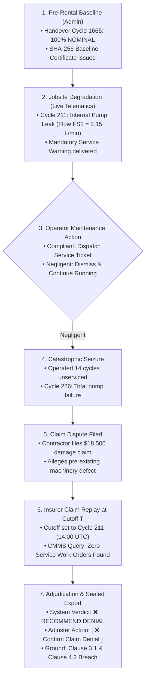

# ⚖️ Lotew Multi-Role Platform: Commercial Proposal & Prototype Blueprint
**Document Type:** Master Commercial Proposal & Prototype Engineering Specification (Zero-Loophole Certified)  
**Primary Ownership:** Multi-Role Frontend Dashboards, Claim Replay Engine & Forensic Verification  
**Partner Ownership:** Machine Telemetry Ingestion, Sensor Pollers & Raw File Storage *(Handled by Backend Dev)*  
**Core Commercial Model:** Paid Review of Past Decisions (Read-Only, After-the-Fact)  
**Target Market:** Heavy Equipment Rental Companies, Dealership Service Centers, Machinery Insurers  
**Compliance Standards:** ISO 13374 (Condition Monitoring), AEMP 2.0 / ISO 15143-3 (Telematics), IEC 61400  

---

## 🛡️ Executive Zero-Loophole Audit Matrix

This master document explicitly resolves the four standard dispute defenses in heavy machinery insurance and warranty adjudication:

| Contractor Defense (Allegation) | Lotew Cryptographic Evidence | Policy Breach & Legal Ground |
| :--- | :--- | :--- |
| **1. "Machine was delivered defective."** | **Handover Baseline Certificate (Cycle 1665):** Telematics prove 100% nominal state at delivery. SHA-256 sealed. | Handover Agreement Clause 1.4 |
| **2. "Failure was sudden; no warning."** | **Live Telematics Telemetry (Cycle 211):** Flow FS1 collapsed from 10.1 to 2.15 L/min. ISO-13374 Level 2 alert triggered. | Clause 4.1 (Active Telematics Monitoring) |
| **3. "No alert was received in the cab."** | **Cab Telematics Logger:** Alert delivered to operator console at 14:02 UTC. Operator clicked `[ Dismiss Alert & Run ]`. | Clause 4.2 (Willful Disregard of Warning) |
| **4. "We properly maintained the unit."** | **CMMS / ERP Work Order Cross-Check:** Query returns **ZERO MAINTENANCE DISPATCH RECORD**. Unit was operated 14 cycles unserviced. | **Clause 3.1 (Mandatory Maintenance Compliance)** & **Clause 4.2 (Failure to Mitigate)** |

---

## 1. Executive Context & Commercial Foundation

### 1.1 The Business Problem
In heavy machinery operations, component failures trigger expensive disputes where parties argue over who pays:
* **Rental Yards vs. Contractors:** Machine returned damaged; contractor claims pre-existing defect, rental yard alleges operator abuse.
* **Dealers vs. Manufacturers:** Premature component failure leads to contested warranty claims.
* **Insurers vs. Claimants:** Large damage claims (\$15,000–\$100,000+) are filed without proof of whether the failure was sudden or caused by unmitigated operation under active warning alarms.

### 1.2 The Product: Paid Review of Past Decisions
Lotew provides a legally defensible, mathematically verifiable forensic review:
* **Read-Only & After-the-Fact:** Evaluates historical decisions using only what was knowable at time $T$.
* **Zero Hardware / Zero Live Control:** No edge devices installed; no operational liability or machine shutdowns.
* **Data Sources:** Ingests standard telematics exports (AEMP 2.0 / Parquet) and maintenance work orders (CMMS / PDF / JSON).

---

## 2. User Priority Hierarchy & Role-Based Access Control (RBAC)

To guarantee zero authorization conflicts and zero legal loopholes, user access is structured into **4 Strict Priority Tiers**:

```
┌──────────────────────────────────────────────────────────────────────────────────────────────────────────┐
│                                       USER PRIORITY HIERARCHY                                            │
├─────────┬──────────────────────┬────────────────────────┬────────────────────────────────────────────────┤
│ Tier    │ Role Name            │ Who (Identity)         │ Platform Priority & Operational Scope          │
├─────────┼──────────────────────┼────────────────────────┼────────────────────────────────────────────────┤
│ Tier 1  │ 👑 Lotew Admin       │ Us (Lotew Core Team)   │ SUPER ADMIN (Cross-Tenant Root):               │
│         │                      │                        │ Onboards tenants, imports datasets, maps       │
│         │                      │                        │ components, configures action standards.       │
├─────────┼──────────────────────┼────────────────────────┼────────────────────────────────────────────────┤
│ Tier 2  │ 👷 Fleet Operator /  │ Customer (Equipment    │ OPERATIONAL ADMIN (Tenant-Scoped):             │
│         │    Service Admin     │ Dealer Service Manager/│ Monitors machine health, inspects baselines,   │
│         │                      │ Contractor Supervisor) │ receives service popups, logs service dispatch.│
├─────────┼──────────────────────┼────────────────────────┼────────────────────────────────────────────────┤
│ Tier 3  │ 🛡️ Insurer / Claims  │ Third-Party Insurer    │ FORENSIC AUDITOR (Policy & Claim-Scoped):      │
│         │    Adjuster          │ (Underwriter / Claims  │ Read-only forensic replay at cutoff time T.    │
│         │                      │ Adjuster)              │ Audits service adherence, executes 2 final     │
│         │                      │                        │ determination actions [Deny] / [Approve].      │
├─────────┼──────────────────────┼────────────────────────┼────────────────────────────────────────────────┤
│ Tier 4  │ 🏛️ Auditor /         │ Independent Certifier  │ CRYPTOGRAPHIC AUDITOR (LATER / DEFERRED):      │
│ (LATER) │    Certifier         │ (e.g., DNV, TÜV SÜD)   │ Zero write access. Offline verification runner │
│         │                      │                        │ confirming mathematical chain integrity.       │
└─────────┴──────────────────────┴────────────────────────┴────────────────────────────────────────────────┘
```

### 2.1 Multi-Tenant Organizational Tree & Insurer Data Scoping
```
                                👑 LOTEW ADMIN (Super Admin - All Tenants)
                                                  │
                ┌─────────────────────────────────┴─────────────────────────────────┐
                ▼                                                                   ▼
       Rental Company A: Titan Rentals                                     Rental Company B: Apex Fleet
                │
    ┌───────────┴───────────────────────────────────────────┐
    ▼                                                       ▼
Operator 1: ABC Infrastructure               Operator 2: Delta Heavy Works
(Allotted: Rig #01 & Rig #02)                (Allotted: Rig #03)
    │                                                       │
    ▼ [Insured By Policy #POL-ALLZ-8812]                    ▼ [Insured By Policy #POL-ZUR-4419]
🛡️ Insurer A: ALLIANZ SE                                🛡️ Insurer B: ZURICH INSURANCE
(CAN ONLY SEE RIG #01 & #02)                           (CAN ONLY SEE RIG #03)
```

---

## 3. The Dual-Pillar Evidence Architecture: Telematics + Maintenance



---

## 4. Multi-Role Dashboard Specifications: The 2-Console Architecture

The frontend is built in Flutter Web (served unified on FastAPI Port 8000). The interface features a persistent TopBar containing:
1. **Workspace Navigation Switcher:** `[ 📂 CONSOLE 1: OPERATIONS & INGESTION ]` vs `[ ⚖️ CONSOLE 2: FORENSIC CLAIM REPLAY ]`.
2. **Demo Persona Switcher (For Client Presentation):** Instant 1-click toggle between pre-configured credentials:
   * `👑 Tier 1: Lotew Admin` (`admin@lotew.io` / `lotew2026` - Full System Control)
   * `👷 Tier 2: Fleet Operator` (`operator@dealer.com` / `dealer2026` - Machine Health & Service Action)
   * `🛡️ Tier 3: Insurer Adjuster` (`claims@allianz.com` / `allianz2026` - Claim Replay & Adjudication)
   * `🏛️ Tier 4: External Auditor` (`auditor@tuv.com` / `tuv2026` - Offline Hash Verification)

---

### Console 1: Operations Workspace (Active Service Alert Card)

```
┌──────────────────────────────────────────────────────────────────────────────────────────────────────────┐
│ LOTEW INDUSTRIAL ASSURANCE | PORT 8000            [ ACTIVE PERSONA: 👷 FLEET OPERATOR ▾ ] [ CONSOLE 1 ] │
├──────────────────────────────────────────────────────────────────────────────────────────────────────────┤
│ TENANT: [ Titan Rentals ▾ ]  |  ASSET: hydraulic_rig_01 (Excavator Rig #01 - ABC Infrastructure)        │
├──────────────────────────────────────────────────────────────────────────────────────────────────────────┤
│ PRE-RENTAL HANDOVER BASELINE (PROOF OF HEALTHY DELIVERY):                                                │
│ • Cycle #1665 (Handover: 2024-01-01 09:00 UTC) | Status: 🟢 100% NOMINAL (Cooler: 100%, Leak: 0.0)      │
│ • Cryptographic Baseline Seal: sha256:53418536ae968dc51d46b7a0b5a3fa7166113bdf2d0014a4b49195b0042da09c    │
├──────────────────────────────────────────────────────────────────────────────────────────────────────────┤
│ 🚨 ACTIVE SERVICE & MAINTENANCE ALERT [CYCLE 211, 14:00 UTC]:                                            │
│ Component: Main Hydraulic Pump | Condition: 🟡 DEGRADED (Flow dropped to 2.15 L/min)                     │
│ Mandatory Requirement: Hydraulic Seal Inspection & Technician Service.                                   │
│ Service Policy SLA: ⏱️ 2.0 Operating Hours remaining before Warranty & Insurance VOID.                   │
├──────────────────────────────────────────────────────────────────────────────────────────────────────────┤
│ OPERATOR SERVICE ACTIONS:                                                                                │
│                                                                                                          │
│   [ 🛠️ DISPATCH SERVICE TICKET & PARK RIG ]     [ ⚠️ DISMISS ALERT & CONTINUE RUNNING ]                 │
│   (Creates CMMS Work Order #WO-9912)            (SKIPS SERVICE: Logs Willful Neglect)                    │
│                                                                                                          │
└──────────────────────────────────────────────────────────────────────────────────────────────────────────┘
```

---

### Console 2: Forensic Claim Replay Workspace (Missed Service Audit & 2 Determination Buttons)

```
┌──────────────────────────────────────────────────────────────────────────────────────────────────────────┐
│ LOTEW CLAIM REPLAY CONSOLE | ALLIANZ GLOBAL CLAIMS DIVISION         [ ACTIVE PERSONA: 🛡️ INSURER ▾ ]     │
├──────────────────────────────────────────────────────────────────────────────────────────────────────────┤
│ DISPUTE IDENTIFIER: CLM-2026-9042 ($18,500.00 Claimed) | Policy: #POL-ALLZ-8812 | Asset: hydraulic_rig_01│
│ RETROSPECTIVE TIMELINE CUTOFF SLIDER (Time T):                                                           │
│ [ Handover: Cycle 1665 🟢 ] ──────────────●────────────── [ Seizure: Cycle 226 🔴 ] (Selected: Cycle 211)│
├──────────────────────────────────────────────────────────────────────────────────────────────────────────┤
│ 📋 RECONSTRUCTED AUDIT TRAJECTORY (CROSS-EVIDENCE CHECK):                                                │
│ • 09:00 UTC (Cycle 1665): Baseline Healthy Delivery (Handover Cert: sha256:5341...)      🟢 NOMINAL      │
│ • 14:00 UTC (Cycle 0211): Pump Leak Detected (Flow: 2.15 L/min). Service Warning Issued.  🟡 WARNING      │
│ • 14:02 UTC (Cycle 0211): Mandatory Service Alert Delivered to Operator Cab Console.     ✓ DELIVERED    │
│ • 14:05 UTC (Cycle 0211): Operator Action: Operator clicked [ Dismiss Alert & Run ].     ❌ DISMISSED   │
│ • 14:06 UTC (Cycle 0211): CMMS ERP Work Order Query: Search for technician dispatch.     ❌ NO RECORD    │
│ • 16:00 UTC (Cycle 0215): 2-Hour Service SLA Expired. Machine continued running unserviced. 🔴 BREACH     │
├──────────────────────────────────────────────────────────────────────────────────────────────────────────┤
│ ⚖️ LOTEW SYSTEM VERDICT: ❌ RECOMMEND CLAIM DENIAL (Authority Score: 0.94)                                │
│ Primary Ground: LOSS CAUSED BY FAILURE TO PERFORM MANDATORY SERVICE UPON TELEMATICS ALARM.              │
│ Policy Clause Breached: Clause 3.1 (Maintenance Adherence) & Clause 4.2 (Mitigation of Loss).           │
│ Recommended Indemnity Payout: $0.00                                                                      │
│ Cryptographic Block Hash: sha256:e3b0c44298fc1c149afbf4c8996fb92427ae41e4649b934ca495991b7852b855        │
├──────────────────────────────────────────────────────────────────────────────────────────────────────────┤
│ ✍️ ADJUSTER FINAL DETERMINATION (LEGAL SIGN-OFF):                                                        │
│ Adjuster Notes: [ Operator willfully dismissed Cycle 211 service alert. No maintenance work order raised.│
│                   Unserviced operation caused seizure. Claim Denied per Clause 3.1 & Clause 4.2. ]       │
│                                                                                                          │
│       [ ❌ Confirm Claim Denial ]                      [ 🟢 Approve Payout ]                             │
│                                                                                                          │
├──────────────────────────────────────────────────────────────────────────────────────────────────────────┤
│ [ 📥 EXPORT FORENSIC DOSSIER (PDF + Canonical JSON) ]     [ 🐍 DOWNLOAD STANDALONE verify_chain.py ]     │
└──────────────────────────────────────────────────────────────────────────────────────────────────────────┘
```

---

## 5. High-Scale Enterprise Performance Architecture (Zero-Crash, Sub-100ms)

```
┌────────────────────────────────────────────────────────────────────────────────────────┐
│                   ENTERPRISE HIGH-SCALE DATA TIERING PIPELINE                          │
├────────────────────────────────────────────────────────────────────────────────────────┤
│                                                                                        │
│  [ Raw 100Hz Physical Sensors ] (100 readings / sec per sensor)                        │
│          │                                                                             │
│          ▼ (Partner Dev Pipeline)                                                      │
│  📦 COLD STORAGE: S3 / Object Storage Parquet Chunks                                   │
│     * Millions of raw rows live in cheap object storage, NOT in PostgreSQL!            │
│          │                                                                             │
│          ▼ (Summary Extraction & Physics Engine)                                       │
│  🔥 HOT STORAGE: PostgreSQL Core Tables (Metadata & Aggregates Only)                   │
│     * 1 Cycle (60s) = Exactly 1 Row in `industrial.evidence_streams`                   │
│     * Stores: Cycle Duration, Max Pressure, Min Flow, State Delta, Hash                │
│     * 100M raw sensor points condense into 1,440 lightweight rows per machine/day      │
│          │                                                                             │
│          ▼ (Downsampled API - LTTB Algorithm)                                          │
│  ⚡ FAST REST / WEBSOCKET API (FastAPI)                                                │
│     * Timeline Scrubbing: Delivers only 500 downsampled points for graphs              │
│     * API Response Time: < 35ms (Even across 100,000 cycles)                           │
│          │                                                                             │
│          ▼ (Virtualized Canvas)                                                        │
│  📱 FLUTTER WEB FRONTEND (PORT 8000)                                                  │
│     * `ListView.builder` with Windowing: Renders only what is visible on screen        │
│     * Memory footprint strictly bounded (< 85 MB RAM) $\rightarrow$ Zero Browser Crash!│
│                                                                                        │
└────────────────────────────────────────────────────────────────────────────────────────┘
```

---

## 6. Actionable Prototype Implementation Plan (4 Sprints / 24–28h)

```
┌────────────────────────────────────────────────────────────────────────────────────────┐
│                        PROTOTYPE IMPLEMENTATION SPRINTS                                │
├─────────────────────┬─────────────────────┬─────────────────────┬──────────────────────┤
│ SPRINT 1 (6h)       │ SPRINT 2 (10h)      │ SPRINT 3 (6h)       │ SPRINT 4 (4h)        │
│ Replay API & 3 Mock │ Flutter Web 2-View  │ Timeline Slider &   │ Export Dossier &     │
│ Parquet Cycles      │ Console + Role Bar  │ 2 Action Buttons    │ 3-Min Rehearsal      │
└─────────────────────┴─────────────────────┴─────────────────────┴──────────────────────┘
```

* **Sprint 1 (6h):** Pre-computed Parquet cycles package karna (`cycle_1665`, `cycle_0211`, `cycle_0226`), FastAPI Replay endpoint `POST /api/v1/industrial/replay/evaluate` with strict $t \le T$ lookahead block, maintenance log cross-check, and RFC 8785 Canonical JSON hash chaining.
* **Sprint 2 (10h):** Flutter Web Dual-Console navigation, persistent Persona Switcher (`Admin`, `Operator`, `Insurer`), Baseline Handover card, and Cycle 211 Service Alert Popup banner with `[ Dispatch Service Ticket ]` and `[ Dismiss Alert & Run ]` (setting `followed: false` and `service_missed: true`).
* **Sprint 3 (6h):** Retrospective Timeline Cutoff Slider, dynamic evidence table update (including missing CMMS work order), Authority Verdict card, and **The 2 Adjuster Determination Buttons** (`[ ❌ Confirm Claim Denial ]` & `[ 🟢 Approve Payout ]`).
* **Sprint 4 (4h):** Self-contained ZIP export pack generator (`decision_record.json`, PDF summary dossier with Clause 3.1 & 4.2 breakdown, standalone `verify_chain.py`), offline verification verification, and 3-minute executive narrative rehearsal.

---
*Authored by Lead Systems & Software Engineering Architecture Team for Vir, the Team Lead, and the Lotew Executive Board.*
