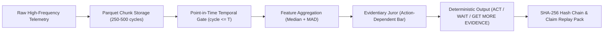
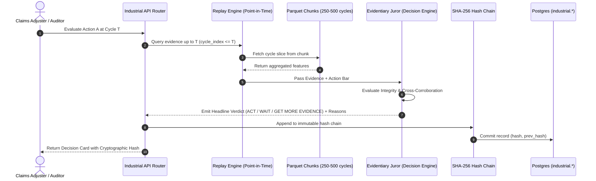

# Lotew Industrial — Architecture Specification & Implementation Blueprint

**Evidentiary Decision Assurance Platform | Architecture, Logic Flows, Database Separation & Technical Alignment**

---

## Core Mission Statement

**Lotew is an Evidentiary Decision Assurance platform designed for industrial insurers, claims adjusters, and auditors.** 

The system does **NOT** predict machine failures, does **NOT** estimate remaining useful life (RUL), and does **NOT** output confidence percentages. Instead, for a specific proposed action at time $T$, Lotew evaluates whether the evidence available strictly up to $T$ justifies taking that action, explains why, and commits a tamper-evident cryptographic SHA-256 record.

---

## 1. Architectural Scope & Target System Adoption

To integrate the new industrial datasets without compromising existing athlete/health pilots, we are adopting a completely decoupled architecture inside the backend:

* **Dedicated Industrial Namespace (`app/industrial/`):** All industrial models, services, adapters, and API endpoints reside in a separate directory within `lotew_backend`. The existing biometric code (`lotew_physiology`) remains 100% isolated and untouched.
* **Strict Database Separation:** Physiological telemetry remains in `lotew_physiology`. Industrial data resides in an isolated database domain (`lotew_industrial`) with multi-tenancy enabled per dataset.
* **The 7 Uniform Core Tables:** Every tenant within `lotew_industrial` implements an identical core schema: `assets`, `components`, `evidence_streams`, `decisions`, `outcomes`, `hash_chain`, and `users_roles` (supported by `action_rules` and `replay_runs`).
* **Storage Layer Separation:** Raw high-frequency telemetry stays in chunk-partitioned Parquet files in object storage (~250–500 cycles per chunk). The relational database stores only stream metadata, content hashes, and decision records.
* **Decoupled Frontend Workflows:** The system surfaces two focused roles for the demo:
  * **Lotew Admin:** Dataset import, asset setup, action bar definitions.
  * **Insurer:** Claim Replay timeline, decision audit cards, PDF/JSON pack export.

---

## 2. Database Separation & Multi-Tenant Topology

An absolute boundary separates physiological and industrial operations. Within the industrial domain, each dataset functions as an isolated customer tenant:

| Tenant ID | Asset Example | Key Components | Primary Evidence Sensors |
| :--- | :--- | :--- | :--- |
| `hydraulic_lab` | Hydraulic Rig (Press-02) | Pump, Valve, Cooler, Accumulator | Pressure PS1–PS6, Flow FS1–FS2, Temp TS1–TS4, Vibration VS1 |
| `metro_porto` | Train Air Compressor (APU) | Compressor, Air Dryers, Oil System | 7 Analog (TP2, TP3, Oil temp, Motor current) & 8 Digital signals |
| `scania_fleet` | Scania Trucks (Fleet) | Component X | Operational counters, histograms, and workshop repair records |
| `petrobras_3w` | Offshore Oil Wells | Wellhead, Choke, Downhole Sensors | Pressure and temperature series across labeled transient events |

### Database Provisioning Options

* **Option A — Dedicated PostgreSQL Schema (`industrial`) in Current Database (Recommended for Demo):**
  Run `CREATE SCHEMA industrial;` in Supabase. The 7 industrial tables reside under `industrial.*` while athlete tables remain under `public.*`. Guarantees 100% table and migration isolation with zero extra infrastructure cost.
* **Option B — Separate Physical Database Project (Target for Production):**
  Deploy a dedicated Supabase project with its own `DATABASE_URL_INDUSTRIAL`, providing independent connection pools and compliance boundaries. Zero code changes are required to transition from Option A to Option B.

### 2.1 Multi-Tenancy Architecture & Isolation Lifecycle

To guarantee strict compliance across commercial partners, multi-tenancy is enforced at three distinct layers:

1. **Database-Level Isolation:**
   - Every core table (`assets`, `components`, `evidence_streams`, `decisions`, `hash_chain`, `action_rules`, `users_roles`) enforces a mandatory `tenant_id VARCHAR(50) NOT NULL INDEX`.
   - API middleware automatically extracts the `tenant_id` from the authenticated user's JWT token and injects it into all database session queries (`WHERE tenant_id = :tenant_id`), preventing cross-tenant data leaks.
2. **Object Storage Isolation:**
   - Parquet telemetry chunks are strictly partitioned by tenant:
     `s3://lotew-data/parquet/{tenant_id}/{asset_id}/chunk_{start}_{end}.parquet`
   - Signed pre-signed URLs are scoped per tenant; Tenant A can never read Tenant B's telemetry files.
3. **Cryptographic Chain Isolation:**
   - The SHA-256 hash ledger is partitioned strictly by `(tenant_id, asset_id)`. Each asset maintains an independent cryptographic chain, eliminating cross-tenant database locking and ensuring that an audit on one asset never affects another.
4. **Role Scoping per Tenant:**
   - User permissions are bound by `(tenant_id, role)`:
     - `Lotew Admin`: Global platform operator; can provision tenants and import datasets.
     - `Plant Operator`: Scoped to a specific tenant; can monitor assets and acknowledge decisions.
     - `Insurer Auditor`: Read-only forensic access, strictly scoped to assets with active policy consent.

---

## 3. End-to-End Decision Workflow (UCI Hydraulic Demo)

1. **Telemetry Ingestion & Parquet Partitioning:** The Ingestion Simulator reads raw sensor text files (PS1–PS6, FS1–FS2, TS1–TS4, VS1) and saves them in chunk-partitioned Parquet files (~250–500 cycles per chunk). Sensor metadata and SHA-256 partition hashes are stored in `evidence_streams`.
2. **Out-of-Band Outcomes Ingestion:** `profile.txt` is ingested into the `outcomes` table (cooler condition, valve condition, internal pump leakage $0 \rightarrow 1 \rightarrow 2$, accumulator pressure). The evaluation engine NEVER reads this table during verdict computation; it is queried solely during Claim Replay post-mortem.
3. **Action-Dependent Evidentiary Bars:** The engine evaluates `(Proposed Action, Cycle T)` against explicit action bars:
   * **Healthy Asset Gating:** If operating normally, intrusive actions (e.g., 'Replace pump', 'Emergency stop') return **`WAIT`** (Reason: `ACTION_NOT_INDICATED`).
   * **Low-Risk Action ('Schedule visual inspection'):** Single-sensor drift justifies action $\rightarrow$ **`ACT`**.
   * **High-Risk Action ('Replace pump'):** Requires multi-sensor cross-corroboration (e.g., pressure drop confirmed by flow drop). If uncorroborated $\rightarrow$ **`GET MORE EVIDENCE`**.
   * **Structured Output:** Emits `missing_evidence` (e.g., `['second pressure reading (PS2)', 'valve inspection']`) and `what_would_change_this` (`'A second pressure reading in the next 30 minutes'`).
4. **Strict Point-in-Time Temporal Gate:** When evaluating at cycle $T$, all queries enforce `WHERE cycle_index <= T`. Future data is strictly invisible to the engine, ensuring legally defensible records.
5. **Claim Replay & Liability Attribution:** When reviewing a catastrophic failure (e.g., pump leakage = 2 at cycle 1,350), Claim Replay rewinds the timeline to audit prior decisions (cycles 900, 1,150, 1,280). It checks whether Lotew's verdict was followed (`followed: true/false`), exposing whether operator error or unjustified intervention caused the failure.  
   *(Note: An operational scenario log is imported alongside UCI data to supply historical operator actions).*
6. **Cryptographic SHA-256 Hash Chain & Export:** Every decision is appended to an immutable chain:
   $$\text{hash}_n = \text{SHA-256}\Big(\text{CanonicalJSON}(\text{Record}_n) + \text{hash}_{n-1}\Big)$$
   Users export the Decision Record Pack as a human-readable PDF (for adjusters) and machine-readable JSON (for enterprise audit systems). Any post-facto alteration breaks chain verification.

---

## 4. Architecture Requirements & Implementation Summary

| Architecture Area | System Specification | Action Required |
| :--- | :--- | :--- |
| **Core Paradigm** | **Decision Assurance:** Evaluates whether available evidence at time $T$ justifies a specific proposed action. No failure prediction or RUL. | Implement an evidentiary justification engine evaluating proposed actions against evidence instead of predicting failure timelines. |
| **System Output** | **Strict 3-Way Verdict:** `ACT`, `WAIT`, or `GET MORE EVIDENCE` + explicit `missing_evidence` list and `what_would_change_this`. No percentages. | Define strict Pydantic schemas for the 3 verdicts and ensure every decision response includes structured reasons and missing evidence items. |
| **Authority Role** | **Evidentiary Juror:** Evaluates whether evidence meets the specific action's threshold. Does not generate autonomous operational commands. | Structure the Authority engine as an evaluator of proposed human/system actions rather than an autonomous recommendation generator. |
| **Action-Dependent Bar** | The evidentiary bar depends on the action. Same data can justify an inspection (`ACT`) but not an emergency stop (`GET MORE EVIDENCE`). | Build an `action_rules` configuration engine where each action type defines its required evidentiary criteria (sensor count, corroboration). |
| **Telemetry Storage** | Raw high-frequency time series remain in Parquet files in object storage (~250–500 cycles/chunk). Database stores metadata and hashes. | Preprocess raw cycle telemetry into chunked Parquet files; store only stream URIs and SHA-256 partition content hashes in `evidence_streams`. |
| **Outcomes & Look-Ahead** | **Strict No Look-Ahead:** Future outcomes (`profile.txt`) are strictly invisible during evaluation. Joined only during Claim Replay post-mortem. | Completely isolate the `outcomes` table from live decision evaluation; enforce strict `cycle_index <= T` query filtering on all evidence retrievals. |
| **Primary Persona** | **Claim Replay for Insurers:** Auditing prior decisions leading up to a machine failure to determine liability and policy adherence. | Develop Claim Replay API endpoints and timeline services to expose historical decisions, adherence checks (`followed: true/false`), and failure attribution. |
| **Audit & Integrity** | **Cryptographic Assurance:** Each decision embeds a SHA-256 hash chaining to the previous record. Exportable as PDF and JSON packs. | Implement RFC 8785 canonical JSON serialization with 6-decimal float formatting and SHA-256 hash chaining; build export endpoints for PDF + JSON. |
| **Domain Isolation** | **Tenant-Scoped Industrial Domain:** All industrial datasets live in `lotew_industrial` across uniform tenants; `lotew_physiology` remains untouched. | Implement the 7 core tables under the dedicated `app/industrial/` namespace, configured with `tenant_id` scoping across all queries. |

---
*Maintained in Lotew Industrial Documentation.*

